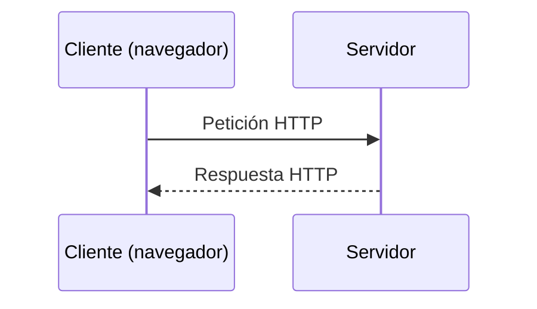
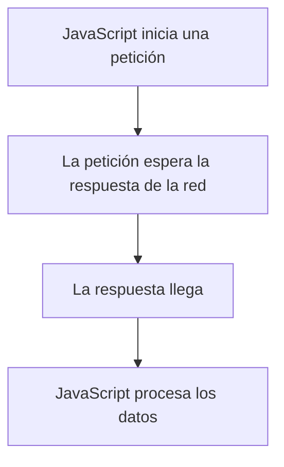

# JavaScript — Clase 7: HTTP, APIs y asincronía con async/await

## Objetivo de la clase

Entender cómo se comunican el navegador y un servidor, qué significan HTTP y HTTPS, cómo se organizan las peticiones y respuestas, y cómo consultar una API desde JavaScript.

No hace falta memorizar todos los métodos ni escribir las expresiones de memoria. Lo importante es reconocer los conceptos y saber probar una petición.

---

# 1. ¿Cómo funciona la web?

Cuando abrimos una página o una aplicación consulta datos, normalmente hay una comunicación entre un **cliente** y un **servidor**.

- **Cliente:** el navegador o nuestra aplicación.
- **Servidor:** el sistema que recibe la petición y devuelve una respuesta.
- **HTTP:** el protocolo que define cómo se comunican.
- **URL:** la dirección del recurso al que queremos acceder.



Una página puede pedir HTML, CSS, imágenes o datos. Cuando una aplicación necesita datos sin recargar toda la página, JavaScript puede hacer una petición HTTP en segundo plano.

## HTTP y HTTPS

**HTTP** significa *Hypertext Transfer Protocol*. Define cómo se realizan las peticiones y cómo se devuelven las respuestas.

**HTTPS** es HTTP protegido mediante TLS. Ayuda a cifrar la comunicación y a comprobar la identidad del servidor.

- `http://` — la comunicación no está protegida por TLS.
- `https://` — la comunicación utiliza TLS.

En aplicaciones reales debemos usar HTTPS, especialmente cuando se transmiten credenciales o datos personales. HTTPS protege la comunicación, pero no garantiza por sí solo que una web sea legítima o que la aplicación esté libre de errores.

---

# 2. ¿Qué contiene una petición y qué contiene una respuesta?

Una petición HTTP puede incluir:

- **Método:** qué queremos hacer (`GET`, `POST`, etc.).
- **URL:** a qué recurso nos dirigimos.
- **Headers (cabeceras):** información adicional, como el formato de los datos.
- **Body (cuerpo):** datos que enviamos cuando hace falta, por ejemplo al crear un registro.

La respuesta suele incluir:

- **Código de estado:** cómo ha terminado la petición.
- **Headers:** información sobre la respuesta.
- **Body:** el contenido devuelto, por ejemplo JSON, HTML o una imagen.

Ejemplo conceptual:

```http
GET /products/3 HTTP/1.1
Host: example.com
Accept: application/json
```

Una respuesta posible:

```http
HTTP/1.1 200 OK
Content-Type: application/json

{
  "id": 3,
  "name": "Teclado"
}
```

No hace falta memorizar esta sintaxis. Quédate con la idea: **el cliente pide un recurso y el servidor responde con un estado y, normalmente, contenido**.

---

# 3. Métodos HTTP y CRUD

Los métodos indican la intención de la petición. En una API que gestiona productos, por ejemplo, podríamos usar:

| Operación | Método | Ejemplo de endpoint |
|---|---|---|
| Leer productos | `GET` | `/products` |
| Leer un producto | `GET` | `/products/3` |
| Crear un producto | `POST` | `/products` |
| Reemplazar un producto | `PUT` | `/products/3` |
| Actualizar parte de un producto | `PATCH` | `/products/3` |
| Borrar un producto | `DELETE` | `/products/3` |

**CRUD** resume cuatro operaciones habituales sobre datos:

- **C — Create:** crear.
- **R — Read:** leer.
- **U — Update:** actualizar.
- **D — Delete:** borrar.

Una correspondencia habitual es `POST`, `GET`, `PUT` o `PATCH`, y `DELETE`. Es una convención muy extendida en APIs REST, aunque los métodos HTTP y CRUD no son exactamente lo mismo.

### Diferencia entre PUT y PATCH

- `PUT`: normalmente envía una representación completa para reemplazar el recurso.
- `PATCH`: envía cambios parciales.

Ejemplo: si un producto tiene nombre, precio y stock, un `PUT` puede enviar los tres campos; un `PATCH` podría enviar solamente el nuevo precio.

---

# 4. Códigos de estado HTTP

El código permite saber qué ha pasado con la petición.

| Rango | Significado | Ejemplos |
|---|---|---|
| `2xx` | La petición ha ido bien | `200 OK`, `201 Created`, `204 No Content` |
| `3xx` | Redirección | `301 Moved Permanently`, `304 Not Modified` |
| `4xx` | Problema relacionado con la petición del cliente | `400 Bad Request`, `401 Unauthorized`, `403 Forbidden`, `404 Not Found` |
| `5xx` | Error del servidor | `500 Internal Server Error`, `503 Service Unavailable` |

Dos ideas importantes:

- `401` suele indicar que falta una autenticación válida.
- `403` indica que el servidor no permite realizar esa operación, aunque el cliente haya sido identificado.

Puedes explorar los códigos en [HTTP Cats](https://http.cat/) o consultarlos en la [documentación de MDN](https://developer.mozilla.org/es/docs/Web/HTTP/Status).

---

# 5. ¿Qué es una API? ¿Y una API REST?

Una **API** es una interfaz que permite que un programa utilice funciones o datos que ofrece otro sistema.

Una **API web** suele exponer recursos mediante URLs y recibir peticiones HTTP. Muchas utilizan JSON para intercambiar datos.

Por ejemplo, una aplicación de una tienda podría pedir `/products` para obtener los productos disponibles.

Una **API REST** sigue una serie de convenciones para organizar recursos y operaciones. En una API de este estilo, los endpoints suelen representar recursos (`/products`, `/users/12`) y los métodos HTTP expresan qué queremos hacer.

## ¿Qué significa que una API sea RESTful?

**REST** es un estilo de arquitectura: un conjunto de principios para diseñar sistemas que se comunican por la web. Se llama **RESTful** a una API que aplica esos principios de forma coherente.

Por ejemplo, una API RESTful suele:

- Organizar las URLs alrededor de **recursos**, como `/products` o `/products/3`.
- Utilizar los métodos HTTP con una intención clara: `GET` para consultar, `POST` para crear, `PUT` o `PATCH` para actualizar y `DELETE` para borrar.
- Ser **stateless** (*sin estado de sesión en el servidor para cada cliente*): cada petición debe incluir la información necesaria para entenderla; no debería depender de recordar una petición anterior.
- Devolver respuestas claras, con códigos de estado HTTP adecuados y, habitualmente, datos en JSON.

No basta con que una API use HTTP o devuelva JSON para que sea RESTful. Lo importante es que su diseño siga estas convenciones de forma consistente. En la práctica, el término se usa a veces con cierta flexibilidad.

Vocabulario que conviene reconocer:

- **Endpoint:** una dirección concreta de una API.
- **Parámetros de ruta:** identifican un recurso, por ejemplo `/products/3`.
- **Query parameters:** añaden opciones a la consulta, por ejemplo `/products?limit=10`.
- **JSON:** formato de texto habitual para intercambiar datos estructurados.

---

# 6. Primera práctica: probar una API con Postman

Antes de escribir JavaScript, podemos probar la petición manualmente.

Usaremos [JSONPlaceholder](https://jsonplaceholder.typicode.com/), una API de prueba que simula datos. No es una base de datos real: las operaciones de escritura simulan la respuesta.

## Prueba A: obtener una publicación

1. Abre Postman.
2. Selecciona el método `GET`.
3. Introduce esta URL:

   `https://jsonplaceholder.typicode.com/posts/1`

4. Pulsa **Send**.
5. Observa el código de estado y el JSON recibido.

La respuesta incluye datos como `userId`, `id`, `title` y `body`.

## Prueba B: crear una publicación simulada

1. Selecciona `POST`.
2. Usa la URL:

   `https://jsonplaceholder.typicode.com/posts`

3. En **Body**, selecciona `raw` y formato `JSON`.
4. Envía este contenido:

```json
{
  "title": "Mi primera petición",
  "body": "Estoy aprendiendo HTTP",
  "userId": 1
}
```

5. Pulsa **Send** y observa la respuesta, normalmente con estado `201 Created`.

La API devuelve una representación del nuevo elemento, pero no lo guarda de forma permanente. Es una API para practicar.

---

# 7. JavaScript síncrono y asíncrono

En una ejecución **síncrona**, las instrucciones se ejecutan en orden: la siguiente espera a que termine la anterior.

Algunas operaciones, como pedir datos por internet, pueden tardar un tiempo imprevisible. JavaScript puede esperar el resultado sin bloquear toda la aplicación. Esto es **asincronía**.



Una petición de red no devuelve los datos inmediatamente. Devuelve una **Promise** (*promesa*): un objeto que representa un resultado que estará disponible más adelante o un error.

Una promesa puede estar pendiente, cumplirse o rechazarse.

## `async` y `await`

- `async` declara una función asíncrona. Esa función devuelve una promesa.
- `await` espera el resultado de una promesa dentro de una función `async`.
- `try/catch` permite gestionar errores.

`await` pausa esa función hasta que llega el resultado, pero no bloquea todo JavaScript.

---

# 8. Hacer una petición GET con `fetch` y `async/await`

`fetch()` es una función del navegador para realizar peticiones HTTP. Devuelve una promesa.

```js
async function obtenerPublicacion() {
  try {
    const response = await fetch(
      "https://jsonplaceholder.typicode.com/posts/1"
    );

    if (!response.ok) {
      throw new Error(`Error HTTP: ${response.status}`);
    }

    const data = await response.json();

    console.log(data.title);
    console.log(data.body);
  } catch (error) {
    console.error("No se pudo obtener la publicación:", error.message);
  }
}

obtenerPublicacion();
```

### ¿Qué está pasando?

1. `fetch(url)` solicita el recurso.
2. `await` espera la respuesta HTTP.
3. `response.ok` comprueba si el estado es satisfactorio (`200–299`).
4. `response.json()` lee el cuerpo y convierte el JSON en datos de JavaScript. También devuelve una promesa, por eso usamos `await`.
5. `catch` gestiona errores de red y los errores que lancemos con `throw`.

**Importante:** `fetch()` no lanza automáticamente un error cuando el servidor responde `404` o `500`. Por eso comprobamos `response.ok`.

---

# 9. Hacer una petición POST con `fetch`

Para enviar datos, indicamos el método, las cabeceras y el cuerpo de la petición.

```js
async function crearPublicacion() {
  try {
    const response = await fetch(
      "https://jsonplaceholder.typicode.com/posts",
      {
        method: "POST",
        headers: {
          "Content-Type": "application/json"
        },
        body: JSON.stringify({
          title: "Aprendiendo JavaScript",
          body: "Mi primera petición POST",
          userId: 1
        })
      }
    );

    if (!response.ok) {
      throw new Error(`Error HTTP: ${response.status}`);
    }

    const data = await response.json();
    console.log("Publicación creada:", data);
  } catch (error) {
    console.error("No se pudo crear la publicación:", error.message);
  }
}

crearPublicacion();
```

Conceptos nuevos:

- `method`: indica el método HTTP.
- `headers`: indican el formato del contenido enviado.
- `JSON.stringify()`: convierte un objeto JavaScript en texto JSON.
- `response.json()`: convierte el JSON recibido en un valor de JavaScript.

En esta API, el elemento se simula: no se guarda de forma permanente.

---

# 10. ¿Qué ocurre si necesitamos varias peticiones?

Si una petición necesita el resultado de otra, se ejecutan en orden:

```js
async function ejemploSecuencial() {
  const response = await fetch(
    "https://jsonplaceholder.typicode.com/posts/1"
  );
  const post = await response.json();

  const userResponse = await fetch(
    `https://jsonplaceholder.typicode.com/users/${post.userId}`
  );
  const user = await userResponse.json();

  console.log(post.title);
  console.log(user.name);
}
```

Aquí necesitamos primero el `userId` de la publicación para solicitar ese usuario.

Si las peticiones son independientes, podemos lanzarlas en paralelo con `Promise.all()`:

```js
async function ejemploParalelo() {
  const [postsResponse, usersResponse] = await Promise.all([
    fetch("https://jsonplaceholder.typicode.com/posts"),
    fetch("https://jsonplaceholder.typicode.com/users")
  ]);

  if (!postsResponse.ok || !usersResponse.ok) {
    throw new Error("Alguna petición ha fallado");
  }

  const posts = await postsResponse.json();
  const users = await usersResponse.json();

  console.log("Publicaciones:", posts.length);
  console.log("Usuarios:", users.length);
}

ejemploParalelo().catch(error => console.error(error.message));
```

`Promise.all()` espera a que todas las promesas se cumplan. Si una se rechaza, la promesa conjunta también se rechaza. Recuerda que `fetch()` puede resolverse con una respuesta HTTP `404` o `500`; hay que comprobar `response.ok`.

---

# 11. ¿Qué es CORS?

CORS significa *Cross-Origin Resource Sharing*.

Los navegadores aplican restricciones de seguridad cuando una página intenta pedir datos a otro origen. El servidor puede indicar mediante cabeceras si permite esas peticiones.

Un **origen** está formado por protocolo, dominio y puerto. Por ejemplo, `http://localhost:3000` y `http://localhost:5173` son orígenes distintos.

Si una petición funciona en Postman, pero falla desde el navegador con un mensaje de CORS, puede que el servidor no permita ese origen. Postman no aplica las mismas restricciones de seguridad del navegador.

No intentes resolverlo desactivando la seguridad del navegador: normalmente debe configurarse el servidor para permitir los orígenes necesarios.

---

# 12. ¿Qué herramientas conviene conocer?

- **Navegador:** permite inspeccionar peticiones en las herramientas de desarrollador, pestaña *Network*.
- **Postman:** permite construir y probar peticiones HTTP sin escribir código.
- **`fetch`:** permite hacer peticiones desde JavaScript.
- **`curl`:** permite probar peticiones desde una terminal.

No vamos a estudiar ahora `XMLHttpRequest` ni jQuery AJAX. Son formas más antiguas de hacer peticiones; para nuestros ejemplos utilizaremos `fetch`.

---

# Práctica de clase

## Parte 1 — Postman

- [ ] Haz un `GET` a `https://jsonplaceholder.typicode.com/posts/1`.
- [ ] Haz un `GET` a `https://jsonplaceholder.typicode.com/users/1`.
- [ ] Haz un `POST` con un título y un cuerpo propios.
- [ ] Prueba un recurso que no exista: `https://jsonplaceholder.typicode.com/posts/9999`. Observa el estado y la respuesta.

## Parte 2 — JavaScript

- [ ] Copia el ejemplo de `obtenerPublicacion()` y ejecútalo.
- [ ] Cambia el número `1` por `2` en la URL. ¿Qué cambia?
- [ ] Modifica el código para mostrar también el `title` y el `body`.
- [ ] Cambia la URL por una que no exista. ¿Por qué es importante comprobar `response.ok`?
- [ ] Ejecuta el ejemplo de `crearPublicacion()` y localiza el objeto devuelto.
- [ ] Reto opcional: pide los datos de un usuario y muestra su nombre junto al título de una publicación.

---

# Ideas clave

- HTTP define cómo se comunican clientes y servidores; HTTPS protege esa comunicación mediante TLS.
- Una petición tiene método, URL y, cuando hace falta, cabeceras y cuerpo.
- El servidor responde con un estado y, normalmente, un cuerpo.
- CRUD significa crear, leer, actualizar y borrar.
- Las APIs permiten que las aplicaciones intercambien datos; muchas utilizan JSON.
- `fetch()` devuelve una promesa. `async/await` hace más legible el trabajo con promesas.
- Comprueba `response.ok`: `fetch()` no considera automáticamente los estados HTTP `4xx` y `5xx` como errores.
- Usa `await` cuando una operación dependa de otra; usa `Promise.all()` para esperar varias operaciones independientes.

## Documentación para consultar

- [MDN: HTTP](https://developer.mozilla.org/es/docs/Web/HTTP)
- [MDN: métodos HTTP](https://developer.mozilla.org/es/docs/Web/HTTP/Methods)
- [MDN: códigos de estado HTTP](https://developer.mozilla.org/es/docs/Web/HTTP/Status)
- [MDN: HTTPS](https://developer.mozilla.org/es/docs/Glossary/HTTPS)
- [MDN: Fetch API](https://developer.mozilla.org/es/docs/Web/API/Fetch_API)
- [MDN: async functions](https://developer.mozilla.org/es/docs/Web/JavaScript/Reference/Statements/async_function)
- [MDN: Promise.all()](https://developer.mozilla.org/es/docs/Web/JavaScript/Reference/Global_Objects/Promise/all)
- [JSONPlaceholder](https://jsonplaceholder.typicode.com/)
- [Postman](https://www.postman.com/)