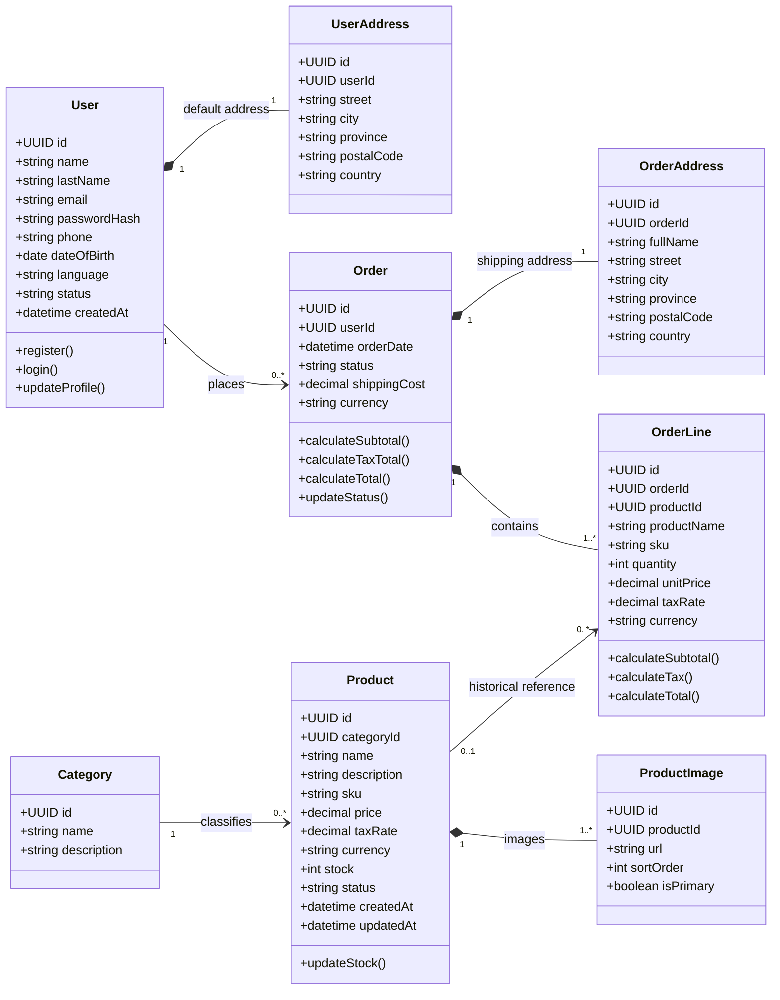

# Diagramas de clases UML: lo básico con Furniro

## 1. ¿Qué es un diagrama de clases?

Un diagrama de clases es un dibujo que representa la estructura de una
aplicación.

Nos ayuda a ver:

-   Qué tipos de objetos existen.
-   Qué información guarda cada uno.
-   Qué acciones puede realizar.
-   Cómo se relacionan entre sí.

Por ejemplo, en Furniro tenemos usuarios (`User`), productos (`Product`) y pedidos (`Order`).

## 2. ¿Cómo se representa una clase?

Una clase suele dibujarse como un rectángulo dividido en tres partes:

``` text
+--------------------------+
|         Product          |  Class name
+--------------------------+
| id: UUID                 |  Attributes
| name: String             |
| price: Decimal           |
| taxRate: Decimal         |
| stock: Integer           |
+--------------------------+
| updateStock()            |  Method
+--------------------------+
```

-   **Nombre:** qué representa la clase.
-   **Atributos:** qué datos necesita guardar.
-   **Métodos:** qué acciones puede realizar.

No todas las clases necesitan métodos en el diagrama. Podemos mostrar
solo los más importantes para entender el diseño.

## 3. Atributos: los datos de una clase

Un atributo se escribe normalmente así:

``` text
nombre: Tipo
```

Ejemplos de Furniro:

  Atributo            ¿Qué representa?
  ------------------- -------------------------------------
  `id: UUID`          Identificador único del producto.
  `nombre: String`    Nombre que se muestra en la tienda.
  `precio: Decimal`   Precio del artículo.
  `stock: Integer`    Unidades disponibles.
  `moneda: String`    Moneda del precio, por ejemplo EUR.

Usamos `UUID` para identificar cada registro de forma única. `String`
representa texto, `Integer` un número entero y `Decimal` un número con
decimales, adecuado para importes monetarios.

## 4. Métodos: las acciones

Los métodos representan acciones relacionadas con una clase.

Por ejemplo:

``` text
Product
-------------------------
+ updateStock()
```

`actualizarStock()` indica que el producto puede tener una operación
para modificar sus existencias.

Otros ejemplos:

-   `User.login()`
-   `Order.updateStatus()`
-   `OrderLine.calculateSubtotal()`

El diagrama no necesita detallar cómo funciona internamente cada método.
Para eso se escribe el código.

## 5. Relaciones entre clases

Las líneas muestran cómo se conectan las clases.

### Asociación

Una asociación indica que dos clases están relacionadas.

En Furniro, un usuario realiza pedidos:

``` text
User  "1" -------- "0..*" Order
```

Esto significa que un usuario (`User`) puede realizar cero, uno o muchos pedidos (`Order`).
Cada pedido pertenece a un usuario.

### Multiplicidad

Los números que aparecen junto a las líneas indican cuántos objetos
pueden relacionarse.

  Símbolo   Significado
  --------- ------------------
  `1`       Exactamente uno.
  `0..1`    Ninguno o uno.
  `0..*`    Cero o muchos.
  `1..*`    Uno o muchos.

Ejemplo: un pedido debe contener al menos una línea de pedido, por lo
que se representa como `1..*`.

### Composición

Un rombo negro indica composición: una clase contiene partes que forman
parte de ella.

En Furniro, un pedido contiene sus líneas:

``` text
Order "1" *-- "1..*" OrderLine
```

En este modelo, las líneas forman parte del pedido y no tienen sentido
como compras independientes.

### Herencia

La herencia se representa con una línea y un triángulo vacío. Indica que
una clase es un tipo más específico de otra.

En el modelo actual de Furniro no usamos herencia entre `Cliente` y
`Administrador`: ambos se representan con una sola clase `Usuario`, y
sus permisos se distinguen mediante un rol.

## 6. El diagrama de clases de Furniro

Este es el modelo conceptual que hemos preparado para el MVP. Se han
omitido algunos detalles para que sea más fácil de leer.



## 7. ¿Por qué hemos separado estas clases?

### `User`

Representa a la persona que utiliza la aplicación. Puede comprar y
consultar sus pedidos. Si tiene permisos administrativos, también puede
acceder al backoffice.

No creamos una clase `Cliente` y otra `Administrador` porque hemos
decidido utilizar una única entidad de usuario.

### `Product`

Representa un artículo que se puede vender. Cada producto tiene su
propio SKU, precio, moneda y stock.

Por ejemplo, dos sillas de distinto color pueden ser dos productos
diferentes si cada una tiene inventario propio.

### `Category`

Permite agrupar productos y navegar por el catálogo. Aunque en el MVP
las categorías se carguen con un script de base de datos, siguen siendo
parte del modelo porque los productos necesitan estar clasificados.

### `Order`

Representa una compra confirmada. Guarda quién compra, cuándo se
realiza, su estado y sus importes.

### `OrderLine`

Representa un artículo dentro de un pedido. Guarda la cantidad y una
copia de datos como el nombre, el SKU y el precio aplicado.

¿Por qué no consultar siempre el precio actual del producto? Porque
puede cambiar después de la compra. El pedido debe seguir mostrando el
importe original.

### `UserAddress` y `OrderAddress`

Son clases distintas porque representan cosas diferentes:

-   `UserAddress`: dirección habitual guardada en el perfil.
-   `OrderAddress`: dirección utilizada para esa compra.

Si el usuario cambia su dirección habitual, los pedidos antiguos deben
conservar la dirección que se utilizó cuando se realizaron.

### `ProductImage`

Separa las imágenes del resto de datos del producto porque un artículo
puede tener varias imágenes.

## 8. ¿Para qué sirve antes de programar?

El diagrama ayuda a pensar la estructura antes de crear las tablas o
escribir las clases.

Por ejemplo, al diseñar Furniro nos hace detectar que:

-   Un pedido necesita líneas de pedido.
-   Una línea debe indicar qué artículo se compró y a qué precio.
-   Un producto necesita una categoría.
-   Un usuario puede tener muchos pedidos.
-   La dirección de un pedido no debe depender de la dirección actual
    del perfil.

**Importante:** un diagrama de clases no es el código de la aplicación
ni el diseño exacto de la base de datos. Es una guía para decidir qué
elementos existen y cómo se relacionan.

## 9. Resumen

Para leer un diagrama de clases, busca estas tres cosas:

1.  **Rectángulos:** las clases de la aplicación.
2.  **Compartimentos:** los datos y las acciones de cada clase.
3.  **Líneas y símbolos:** las relaciones entre clases y cuántos objetos
    pueden conectarse.

No hace falta memorizar todo UML al principio. Lo importante es saber
explicar por qué existen las clases y qué problema resuelve cada
relación.