# El mundo del desarrollo de software

> **Quiero que, dentro de seis meses, si alguien en una empresa os habla de un microservicio, un event bus, una release, Redux o GitOps, no os quedéis en blanco.**
>
> No espero que sepáis implementarlo. Quiero que os suene, entendáis qué problema intenta resolver y sepáis por dónde empezar a aprender.
>
> Aprender una tecnología sin entender por qué existe puede servir para seguir un tutorial, pero limita lo que podemos hacer después. La tecnología cambia; los problemas que intenta resolver suelen repetirse.

Este material es un **mapa general del mundo del desarrollo profesional**, no un curso avanzado de arquitectura. No hace falta memorizar todos los términos ni entender todos los detalles a la primera. El objetivo es reconocer las piezas, relacionarlas y empezar a hacerse buenas preguntas.

Usaremos como ejemplo una aplicación ficticia de reservas para un gimnasio: **FitClub**. Los usuarios consultan clases, reservan plazas, cancelan reservas y reciben confirmaciones. El personal del gimnasio gestiona horarios y aforo.

---

# Parte 1. El mundo del desarrollo profesional

## 1. Una aplicación no es solo una pantalla

Cuando usamos FitClub, vemos una página web o una aplicación móvil. Pero detrás hay más piezas.

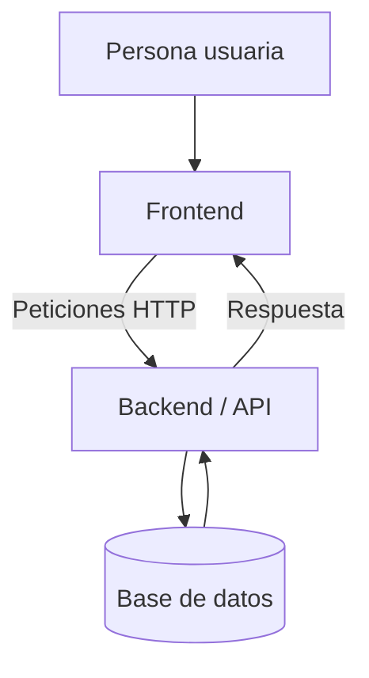

- **Frontend:** la parte con la que interactúa la persona. Muestra información y permite realizar acciones.
- **Backend:** la parte que ejecuta las reglas del sistema. Por ejemplo, comprobar si queda una plaza disponible.
- **API:** una forma definida para que dos partes de un sistema se comuniquen.
- **Base de datos:** donde se guarda la información para consultarla y actualizarla.
- **Servidor:** un ordenador o entorno que ejecuta un servicio y atiende peticiones.
- **Cloud o nube:** servicios informáticos que podemos utilizar a través de un proveedor, sin gestionar por nuestra cuenta toda la infraestructura física.

**Ejemplo:** el frontend no debería decidir por su cuenta que una reserva está confirmada. El backend debe comprobar las reglas correspondientes y responder si la operación se ha podido realizar.

## 2. ¿Quién trabaja en un producto digital?

En una empresa, construir una aplicación requiere más tareas que escribir código. En equipos pequeños una persona puede cubrir varias responsabilidades; en organizaciones grandes suele haber roles más especializados.

| Rol o área | ¿Qué hace? |
|---|---|
| **Product Manager** | Trabaja en la estrategia del producto: qué necesidades abordar, para quién y con qué objetivos. |
| **Product Owner** | Ayuda a ordenar y priorizar el trabajo del producto. En algunas empresas este rol se combina con el de Product Manager; en otras son funciones diferentes. |
| **Diseño UX/UI** | Investiga las necesidades de las personas y diseña cómo se utiliza y cómo se presenta el producto. |
| **Frontend** | Construye y mantiene la interfaz. |
| **Backend** | Implementa reglas, APIs e integración con datos. |
| **QA / testing** | Ayuda a comprobar que el producto funciona como se espera. |
| **DevOps / plataforma** | Facilita la construcción, el despliegue y la operación del software. |
| **Seguridad** | Ayuda a detectar y reducir riesgos en el código, la infraestructura, los accesos y los procesos. |
| **SRE / fiabilidad** | Trabaja para que los servicios sean fiables, medibles y recuperables. |

Los nombres y límites de estos roles cambian de una organización a otra. Lo importante es comprender que el producto se construye entre varias responsabilidades.

## 3. Empresas pequeñas y grandes: no se trabaja igual

En un equipo pequeño, unas pocas personas pueden desarrollar la interfaz, el backend, la base de datos y el despliegue. La comunicación suele ser directa y las decisiones pueden tomarse rápidamente.

En una organización grande puede haber varios equipos, diferentes servicios, revisiones obligatorias, controles de seguridad y procesos de publicación más formales.

No significa que una forma sea siempre mejor. Cuanto mayor es el sistema y más personas participan, más importante resulta coordinar los cambios, definir responsabilidades y reducir riesgos.

## 4. Del cambio de código a producción

Una funcionalidad no está terminada simplemente porque funcione en el ordenador de quien la ha desarrollado.

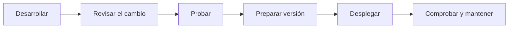

Conceptos habituales:

- **Entorno local:** donde una persona desarrolla y prueba el programa en su ordenador.
- **Pruebas:** comprobaciones para detectar errores y verificar el comportamiento esperado.
- **Preproducción / staging:** entorno parecido al real donde se puede comprobar una versión antes de publicarla.
- **Producción:** entorno real que utilizan los usuarios.
- **Release:** una versión preparada o publicada para su uso.
- **Despliegue:** poner una versión del software en un entorno donde pueda ejecutarse.
- **Hotfix:** una corrección urgente para resolver un problema importante.
- **Rollback:** volver a una versión anterior cuando una actualización provoca problemas.

**Ejemplo:** FitClub publica una versión y, de repente, nadie puede reservar. El equipo necesita detectar el problema, decidir si lo corrige inmediatamente o vuelve a la versión anterior y comprobar que el servicio funciona.

## 5. Git Flow, ramas y Pull Requests

Cuando varias personas trabajan en el mismo repositorio, necesitan una forma de organizar sus cambios.

### Ramas

Una rama permite trabajar en una línea de cambios sin tener que mezclar inmediatamente ese trabajo con la versión principal.

**Git Flow** es una estrategia de trabajo con ramas que define líneas para el desarrollo, la preparación de versiones y las correcciones. Es una estrategia conocida, pero no es la única ni es obligatoria para todos los proyectos. Algunos equipos utilizan enfoques más sencillos, como GitHub Flow.

### Pull Request (PR)

Una **Pull Request** es una propuesta para integrar unos cambios en otra rama. Permite revisar el código, conversar sobre el cambio y ejecutar comprobaciones antes de integrarlo.

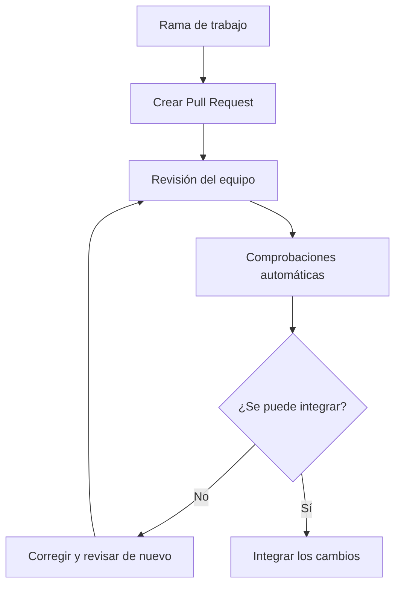

Una revisión puede detectar errores, aclarar decisiones, mejorar la legibilidad o comprobar que el cambio encaja con el proyecto.

**No confundáis:** Git Flow es una estrategia de ramas; una PR es un mecanismo para proponer y revisar cambios; una pipeline automatiza tareas. Se pueden relacionar, pero no son lo mismo.

### Preguntas para conversar

1. ¿Por qué una empresa querría revisar un cambio antes de publicarlo?
2. ¿Qué puede salir mal si cada persona modifica directamente la rama principal?
3. ¿Por qué un hotfix puede necesitar un proceso distinto al de una funcionalidad nueva?
4. ¿Qué responsabilidades del equipo os llaman la atención además de programar?

---

# Parte 2. Cómo desarrollamos software de calidad

Esta parte no trata de aprender una tecnología concreta. Trata de conocer principios, hábitos y formas de organizar el trabajo que ayudan a construir software comprensible y mantenible.

## 1. Clean Code: que el código se pueda entender

**Clean Code** es una filosofía de trabajo orientada a escribir código claro, comprensible y fácil de mantener. No es una receta universal ni consiste en aplicar reglas sin pensar.

Algunas ideas importantes:

- Elegir nombres que expresen la intención.
- Dar a las funciones una responsabilidad clara.
- Evitar duplicar lógica innecesariamente.
- No añadir complejidad antes de necesitarla.
- Escribir código que otra persona pueda comprender.
- Mantener una estructura que facilite los cambios.


Ejemplo mínimo:

```javascript
// Nombre poco descriptivo
function f(a, b) {
  return a - b;
}

// Nombre que expresa la intención
function calcularPlazasDisponibles(aforo, reservas) {
  return aforo - reservas;
}
```

El segundo nombre no hace que la función sea más rápida, pero ayuda a comprender qué representa el resultado. En un proyecto real también habría que comprobar que la operación representa correctamente las reglas del negocio.

## 2. Refactorización: mejorar sin cambiar lo que hace

**Refactorizar** es modificar la estructura interna del código para que sea más claro o fácil de mantener, procurando conservar su comportamiento observable.

Una analogía: reorganizar una cocina para trabajar mejor sin cambiar las recetas que se preparan.

Podemos refactorizar para mejorar nombres, separar responsabilidades, eliminar duplicaciones, simplificar una función difícil de entender o facilitar futuras modificaciones.

Refactorizar no es lo mismo que añadir una funcionalidad nueva. A menudo se hace para que añadirla después resulte más sencillo.


## 3. SOLID: principios de diseño

SOLID agrupa cinco principios de diseño orientado a objetos. Aquí basta con reconocer su intención general.

- **S — Single Responsibility Principle:** una pieza debería tener una responsabilidad bien definida.
- **O — Open/Closed Principle:** intentar que ciertos comportamientos puedan ampliarse sin modificar continuamente código estable.
- **L — Liskov Substitution Principle:** los tipos que sustituyen a otro deben respetar las expectativas que ese tipo establece.
- **I — Interface Segregation Principle:** es preferible no obligar a una pieza a depender de operaciones que no necesita.
- **D — Dependency Inversion Principle:** las partes de alto nivel deberían depender de abstracciones adecuadas, en vez de quedar atadas directamente a detalles concretos.

No intentéis memorizar las cinco definiciones hoy. La idea común es diseñar piezas con responsabilidades claras y relaciones que permitan mantener y ampliar el sistema.

## 4. STUPID: señales de alerta en el diseño

STUPID es un acrónimo informal utilizado para recordar algunos riesgos habituales. La lista puede variar ligeramente según la fuente.

- **Singleton:** usar un único objeto global para demasiadas cosas puede crear dependencias ocultas.
- **Tight Coupling:** las piezas dependen demasiado unas de otras.
- **Untestability:** cuesta probar el código de forma aislada.
- **Premature Optimization:** optimizar antes de conocer el problema real.
- **Indescriptive Naming:** nombres que no explican bien qué hace algo.
- **Duplication:** repetir la misma lógica en muchos lugares.

No significa que cualquier uso de un singleton sea automáticamente malo ni que haya que evitar toda optimización. Son señales de alerta para pensar y revisar decisiones.

## 5. Modularidad y separación de responsabilidades

Una pieza de software tiene una responsabilidad cuando podemos explicar con claridad para qué sirve.

Si una función comprueba permisos, calcula precios, envía correos y actualiza datos, será difícil entenderla y modificarla sin afectar a otras cosas.

Separar responsabilidades ayuda a que cada parte tenga un propósito claro. Pero tampoco significa dividirlo todo en cientos de funciones o archivos: demasiadas piezas también pueden hacer que el sistema sea difícil de seguir.

## 6. Patrones de diseño: soluciones que se repiten

Un **patrón de diseño** es una solución general que se ha demostrado útil ante un tipo de problema recurrente. No es código que haya que copiar literalmente.


Tres ejemplos para reconocer los nombres:

- **Observer:** una parte del sistema puede recibir avisos cuando cambia otra parte.
- **Publish-Subscribe:** quien publica un acontecimiento no necesita conocer directamente a todos los interesados que lo reciben.
- **Strategy:** se pueden intercambiar distintas formas de realizar una operación.
- **Adapter:** permite que dos piezas con interfaces diferentes puedan colaborar.

Por ejemplo, FitClub podría necesitar diferentes formas de calcular un descuento. En vez de mezclar todas las reglas en una función enorme, se puede organizar el diseño para seleccionar una estrategia según el caso.

Los patrones aparecen en libros y en muchas bibliotecas o frameworks, aunque no siempre se utilicen con el nombre explícito. No hace falta reconocerlos todos ni convertir cada problema en un patrón.

## 7. Programación imperativa, funcional y reactiva

Son formas distintas de pensar y organizar un programa. No son tecnologías concretas ni se excluyen siempre entre sí.

### Programación imperativa

Se describen los pasos que debe ejecutar el programa.

**Analogía:** dar instrucciones como «lee el texto, busca las coincidencias y muestra los resultados».

### Programación funcional

Favorece transformar datos mediante funciones y reducir modificaciones innecesarias o efectos secundarios.

**Analogía:** tomar una lista de reservas, aplicar una transformación y obtener otra lista sin modificar inesperadamente la original.

### Programación reactiva

Organiza el sistema para que los cambios en datos o flujos de acontecimientos puedan desencadenar operaciones conectadas.

**Analogía:** al cambiar el texto de un buscador, el flujo procesa ese cambio y actualiza los resultados, sin que cada parte tenga que coordinar manualmente todos los pasos.

La programación reactiva no significa que el programa funcione sin instrucciones: alguien define qué debe suceder. Cambia cómo se conectan los cambios con las operaciones que reaccionan a ellos.

**RxJS** es una biblioteca de JavaScript para trabajar con flujos de valores y acontecimientos a lo largo del tiempo. La encontraremos especialmente en contextos relacionados con Angular y aplicaciones con asincronía compleja.

## 8. Extreme Programming (XP), TDD y BDD

**Extreme Programming (XP)** es una metodología de desarrollo que pone énfasis en prácticas técnicas, colaboración y ciclos de feedback cortos.

Otros términos que conviene reconocer:

- **TDD — Test-Driven Development:** escribir una prueba antes de implementar el comportamiento correspondiente y avanzar a partir de ella.
- **BDD — Behavior-Driven Development:** describir y comprobar el comportamiento esperado mediante ejemplos comprensibles para las personas implicadas.

No vamos a aprender estas metodologías aquí. Las retomaremos cuando hablemos de pruebas y formas de trabajar en equipo.

## 9. DDD: diseñar pensando en el negocio

**DDD** significa *Domain-Driven Design*, o diseño guiado por el dominio.

La idea general es construir el software entendiendo bien el problema del negocio y utilizando conceptos que representen ese problema.

En FitClub, el dominio incluye conceptos como «reserva», «clase», «aforo», «cancelación» y «lista de espera». No es lo mismo una reserva confirmada que una solicitud pendiente.

DDD ayuda a que el diseño del software refleje las reglas y el vocabulario del negocio, en vez de organizarlo únicamente alrededor de detalles técnicos.

## 10. Libros para profundizar en calidad y diseño

No son deberes. Son referencias para cuando queráis seguir investigando.

- **Clean Code — Robert C. Martin.** Legibilidad, nombres, funciones y mantenimiento.
- **Refactoring: Improving the Design of Existing Code — Martin Fowler.** Cómo mejorar la estructura interna preservando el comportamiento.
- **Head First Design Patterns — Eric Freeman y Elisabeth Robson.** Introducción visual a patrones de diseño.
- **The Pragmatic Programmer — David Thomas y Andrew Hunt.** El oficio de desarrollar software, aprender y tomar buenas decisiones.
- **A Philosophy of Software Design — John Ousterhout.** Complejidad, modularidad y diseño.
- **Extreme Programming Explained: Embrace Change — Kent Beck.** Un clásico sobre XP y prácticas de desarrollo.


### Preguntas para conversar

1. ¿Por qué un código puede funcionar y aun así ser difícil de mantener?
2. ¿Qué diferencia hay entre refactorizar y añadir una funcionalidad?
3. ¿Qué riesgo aparece cuando muchas piezas dependen demasiado unas de otras?
4. ¿Por qué un patrón de diseño no debería aplicarse automáticamente a todos los problemas?

---

# Parte 3. Backend y arquitectura de sistemas

## 1. ¿Qué significa arquitectura de software?

La arquitectura es, explicado de forma sencilla, **cómo organizamos las piezas importantes de una aplicación y cómo se relacionan entre sí**.

Imaginad una casa. No basta con elegir los muebles: también hay que decidir dónde van las habitaciones, por dónde pasan las tuberías y cómo se conectan las instalaciones. En software ocurre algo parecido.

La arquitectura ayuda a responder preguntas como:

- ¿Qué responsabilidades tiene cada parte?
- ¿Qué partes pueden cambiar sin afectar demasiado a las demás?
- ¿Cómo se comunican?
- ¿Qué ocurre si una parte falla?
- ¿Cómo podemos mantener y ampliar el sistema?

No existe una arquitectura perfecta para todos los casos.

## 2. Monolito: empezar con una sola aplicación

Un **monolito** es una aplicación que se construye y se despliega como una unidad. Puede tener muchas partes internas y estar muy bien organizada.

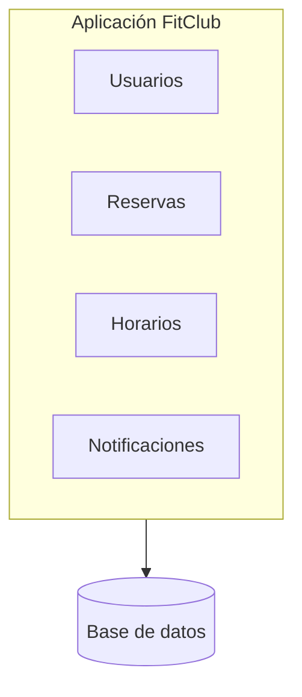


Una aplicación monolítica no tiene por qué ser un montón de código mezclado. Puede estar dividida en módulos y tener responsabilidades bien separadas.

### ¿Por qué puede ser una buena idea?

- Es más sencillo empezar.
- Hay menos piezas que desplegar y vigilar.
- Las partes pueden comunicarse sin necesitar una red entre servicios.
- El desarrollo y la depuración pueden ser más sencillos.

### ¿Qué dificultades pueden aparecer?

Cuando la aplicación crece, los cambios pueden resultar más difíciles de coordinar. Varios equipos pueden necesitar trabajar sobre la misma aplicación, y publicar una modificación pequeña puede requerir desplegar el conjunto.

**Idea importante:** empezar con un monolito no es hacerlo mal. Muchas veces es la opción más razonable. Lo importante es organizarlo bien y cambiar de enfoque cuando haya razones concretas.

## 3. Microservicios: separar un sistema en servicios

Los **microservicios** son una forma de organizar un sistema en varios servicios relativamente independientes. Cada servicio se ocupa de una responsabilidad o área concreta y se comunica con otros mediante mecanismos definidos, por ejemplo APIs o mensajería.

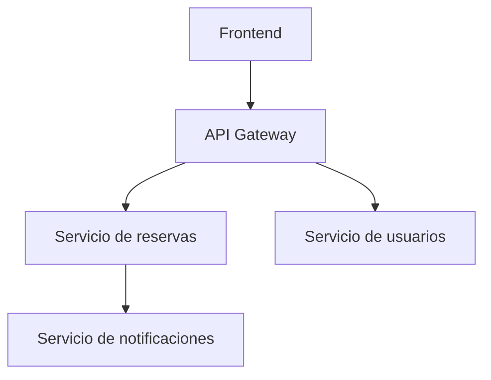

### ¿Por qué aparecieron?

En sistemas grandes, separar partes puede permitir que distintos equipos desarrollen, desplieguen y escalen servicios con mayor independencia. Por ejemplo, quizá el servicio de reservas necesita más capacidad en determinadas horas, mientras que otras partes apenas cambian.

### ¿Qué problemas añaden?

- Hay más piezas que desplegar y mantener.
- La comunicación entre servicios puede fallar.
- Puede ser más difícil saber dónde se ha producido un error.
- Hay que gestionar permisos, redes, versiones y observabilidad.
- Una operación que antes era local puede depender de varios servicios.

**Metáfora:** pasar de una cocina donde una persona prepara todo a un restaurante con varias estaciones especializadas puede ayudar a atender más pedidos, pero exige coordinación.

Microservicios no significa simplemente «hacer muchos proyectos pequeños». La independencia, las responsabilidades y la comunicación entre servicios son parte importante de la idea.

## 4. Comunicación síncrona y asíncrona

### Síncrona: pregunto y espero una respuesta

El frontend solicita las clases disponibles a la API y espera una respuesta para mostrar los resultados.

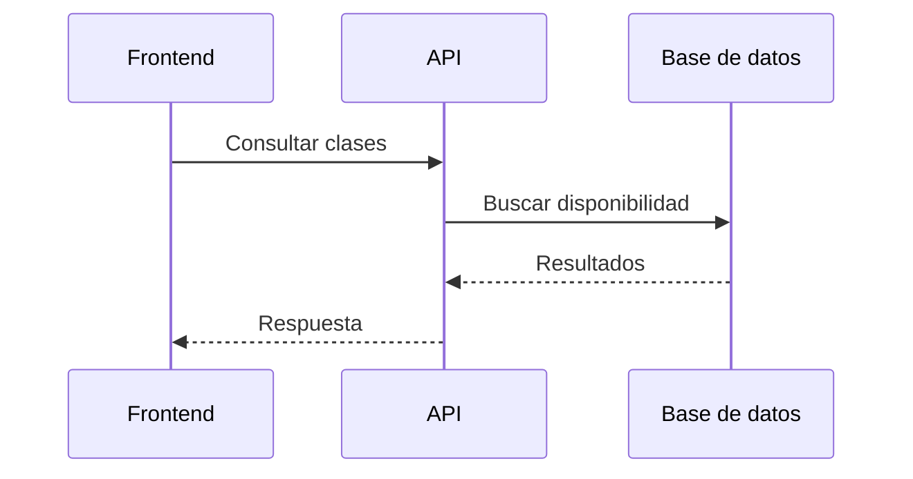

Es un modelo sencillo de entender: una parte hace una petición y espera el resultado.

### Asíncrona: comunico algo y el trabajo continúa

Hay tareas que no necesitan formar parte de la respuesta inmediata. Por ejemplo, después de crear una reserva, enviar una notificación puede realizarse por separado.

La comunicación asíncrona permite desacoplar partes del trabajo, pero introduce preguntas nuevas: ¿qué pasa si el mensaje se retrasa?, ¿si se procesa dos veces?, ¿si falla el consumidor?

## 5. Event bus y arquitectura dirigida por eventos

Primero, una distinción importante:

- **Arquitectura de software:** cómo organizamos las piezas de un sistema.
- **Arquitectura dirigida por eventos:** un enfoque en el que las partes se comunican, en parte, mediante acontecimientos que se producen y otros componentes consumen.
- **Event bus:** un mecanismo o componente que permite distribuir acontecimientos a sus destinatarios.

Imaginad que FitClub registra una reserva. Se produce el acontecimiento **«Reserva creada»**.

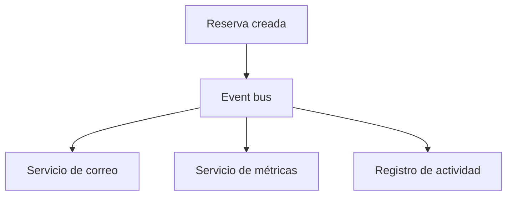


El servicio de reservas no tiene por qué llamar directamente a cada sistema. Publica el acontecimiento y las partes interesadas reaccionan según su responsabilidad.

### ¿Qué ventajas puede tener?

- Separar al emisor del acontecimiento de quienes reaccionan a él.
- Añadir nuevos consumidores sin modificar necesariamente el código que publica el evento.
- Permitir que determinadas tareas se procesen de manera asíncrona.

### ¿Qué dificultades añade?

- Puede ser más difícil seguir el recorrido completo de una operación.
- Los acontecimientos pueden llegar más tarde o repetirse.
- Hay que pensar qué ocurre si un consumidor falla.
- No siempre es fácil saber qué ha sucedido con solo mirar una llamada.

**Observer y Publish-Subscribe están relacionados, pero no son exactamente lo mismo en todas las implementaciones.** Observer suele describir una relación de notificación entre objetos; Publish-Subscribe suele introducir una separación mayor entre quien publica y quien recibe. Un event bus puede servir para implementar una comunicación de tipo Publish-Subscribe.

## 6. API Gateway: una puerta de entrada común

Cuando hay varios servicios, el frontend podría tener que conocer la dirección y las particularidades de cada uno. Un **API Gateway** puede ofrecer un punto de entrada común y dirigir las peticiones al servicio adecuado.

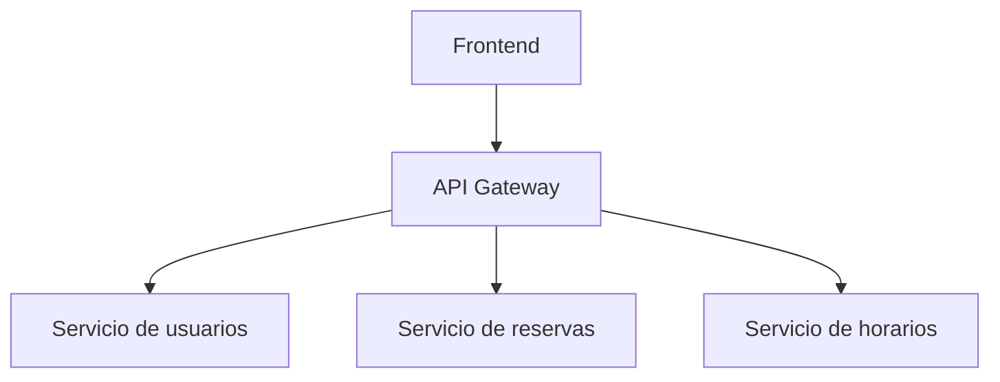

Puede encargarse de tareas como enrutar peticiones y, según la arquitectura, colaborar en aspectos como autenticación, límites de peticiones o registro.

No es una solución mágica que elimina todos los problemas de comunicación. El gateway también se debe configurar, proteger, mantener y vigilar.

## 7. Serverless y funciones gestionadas

**Serverless** suele traducirse como «sin servidor», pero no significa que no existan servidores. Significa que el proveedor gestiona buena parte de la infraestructura sobre la que se ejecuta el código.

En vez de gestionar directamente un servidor, podemos desplegar una función que se ejecuta cuando ocurre un evento o llega una petición.

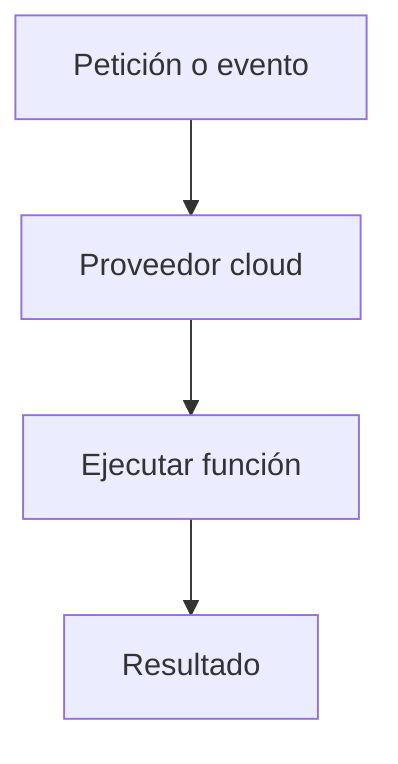

Ejemplos de servicios:

- **AWS Lambda**, en Amazon Web Services.
- **Azure Functions**, en Microsoft Azure.
- **Google Cloud Run functions**, evolución del servicio conocido anteriormente como Google Cloud Functions.

### ¿Qué ventajas puede tener?

- No tenemos que gestionar directamente toda la infraestructura del servidor.
- Puede escalar automáticamente según el servicio y la configuración.
- Resulta útil para tareas activadas por peticiones o eventos.

### ¿Qué dificultades añade?

- Dependemos de las características y límites del proveedor.
- Hay que entender permisos, configuración, tiempos de ejecución y costes.
- Puede ser más complicado probar y depurar ciertos escenarios.
- No todas las aplicaciones encajan bien en este modelo.

Serverless no es lo contrario de microservicios: son conceptos distintos. Un sistema puede utilizar microservicios, funciones gestionadas o una combinación, según sus necesidades.

## 8. ¿Cómo elegir entre monolito, microservicios y serverless?

No hay una respuesta universal.

| Enfoque | Puede encajar cuando… | Hay que tener en cuenta… |
|---|---|---|
| **Monolito** | Queremos desarrollar una aplicación como una unidad, especialmente al empezar. | La organización interna y la coordinación pueden complicarse al crecer. |
| **Microservicios** | Necesitamos separar responsabilidades y permitir mayor independencia entre servicios o equipos. | Aumentan la complejidad operativa y de comunicación. |
| **Serverless** | Queremos ejecutar funciones o tareas sin gestionar directamente toda la infraestructura subyacente. | Existen límites, costes y dependencias del proveedor. |

La decisión debe partir del problema, del tamaño del sistema, de los equipos y de las necesidades operativas. No de que una tecnología esté de moda.

### Preguntas para conversar

1. ¿Por qué un monolito puede ser la mejor opción para un producto pequeño?
2. ¿Qué puede salir mal si un sistema depende de muchos servicios independientes?
3. ¿Qué ventaja aporta un event bus frente a llamar directamente a todos los sistemas?
4. ¿Por qué serverless no significa que no existan servidores?
5. ¿Qué responsabilidad debería tener un API Gateway y qué no debería hacer?

---

# Parte 4. Frontend y arquitectura de interfaces

## 1. ¿Por qué aparecieron las bibliotecas y los frameworks frontend?

En una página pequeña podemos construir la interfaz con HTML, CSS y JavaScript sin demasiadas capas. Cuando una aplicación crece, aparecen más pantallas, componentes, datos y reglas.

El reto no consiste solo en dibujar la página. También hay que mantener la interfaz coherente cuando cambian los datos, reutilizar elementos y controlar las interacciones.

Las bibliotecas y los frameworks frontend ayudan a organizar ese trabajo.

## 2. Componentes: dividir una interfaz en piezas

Un **componente** es una pieza de la interfaz que podemos identificar y reutilizar.

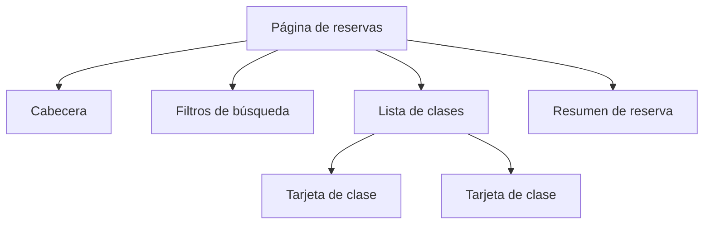

Una página puede montarse con piezas parecidas a las de un juego de construcción. Cada pieza tiene una función y varias pueden combinarse para formar una pantalla.

Reutilizar no significa convertir cada detalle en un componente. Demasiadas piezas pequeñas también pueden dificultar la comprensión.

## 3. React y Angular

**React** es una biblioteca de JavaScript para construir interfaces de usuario mediante componentes. Permite describir cómo debe verse una interfaz a partir de los datos que maneja.

**Angular** es un framework para desarrollar aplicaciones web que incluye una estructura y un conjunto más integrado de herramientas y convenciones.

Ambos ayudan a construir aplicaciones frontend grandes, pero no son idénticos ni se utilizan exactamente de la misma manera.

### React, de forma conceptual

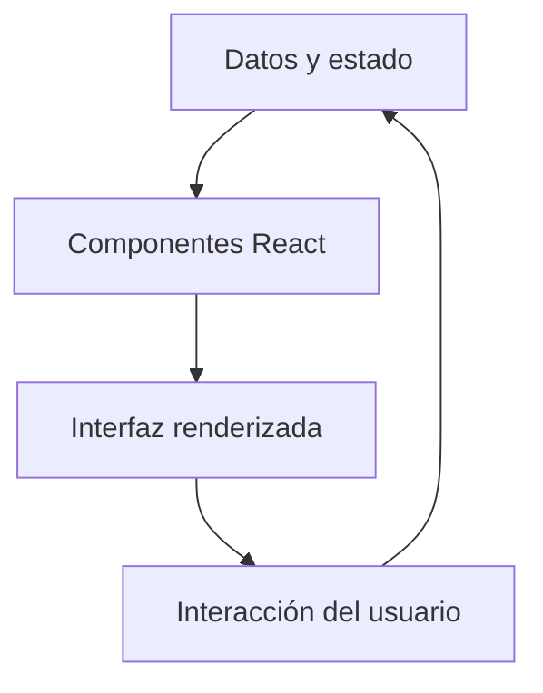

React se centra en construir la interfaz mediante componentes y actualizarla cuando cambian los datos relevantes. El ecosistema permite añadir otras herramientas según las necesidades del proyecto.

### Angular, de forma conceptual

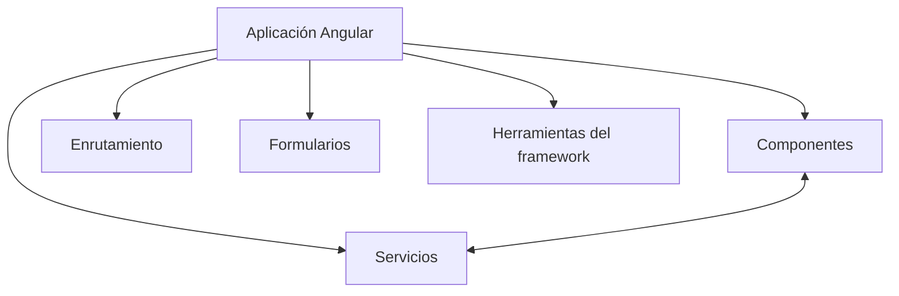

Angular ofrece un conjunto más integrado de convenciones y herramientas para estructurar aplicaciones. Incluye mecanismos para componentes, servicios, formularios, navegación y otras necesidades habituales.

Estos dibujos son simplificaciones conceptuales, no diagramas internos completos de los frameworks.

## 4. ¿Qué es el estado en el frontend?

El **estado** es la información que puede cambiar durante el uso de una aplicación y que afecta a lo que muestra o permite hacer.

En FitClub, algunos ejemplos son:

- Qué texto ha escrito una persona en el buscador.
- Qué filtros ha seleccionado.
- Qué clase está viendo.
- Si el menú está abierto.
- Qué información de una reserva se está mostrando.

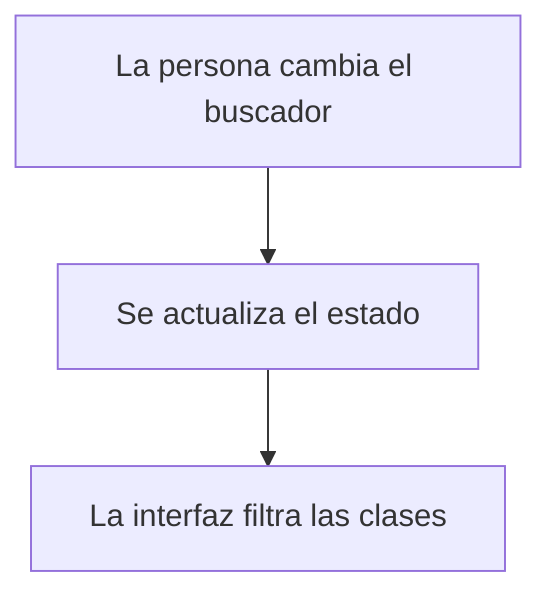

El estado no es lo mismo que la base de datos. La base de datos guarda información persistente del sistema; el estado del frontend puede ser temporal, como el texto que alguien está escribiendo en un buscador.

## 5. Redux y el estado compartido

En una aplicación pequeña, un componente puede gestionar sus propios datos y compartir algunos con otros componentes.

En una aplicación más grande, varias partes pueden necesitar consultar o modificar la misma información. Si cada una mantiene una copia independiente, pueden aparecer inconsistencias y resulta difícil entender quién ha cambiado qué.

**Redux** es una de las herramientas utilizadas para organizar el estado compartido de una aplicación.


Una analogía: en lugar de que cada pantalla lleve su propia libreta con una versión diferente de la disponibilidad de las clases, establecemos una forma común y controlada de consultar y actualizar esa información.

Redux no es obligatorio en todas las aplicaciones. React dispone de mecanismos propios para gestionar estado, y la elección depende de la complejidad y las necesidades del proyecto.

## 6. Programación reactiva y RxJS en frontend

La idea intuitiva es que, en lugar de coordinar manualmente cada paso, podemos conectar los cambios de un flujo con las operaciones que deben reaccionar a ellos.

Por ejemplo, al escribir en un buscador, se puede procesar el nuevo valor, esperar brevemente para evitar consultas innecesarias y actualizar los resultados.

**RxJS** es una biblioteca para trabajar con flujos de valores y acontecimientos a lo largo del tiempo. Se utiliza en distintos contextos de JavaScript y tiene especial presencia en el ecosistema Angular.

No confundáis el nombre React con el concepto de programación reactiva: están relacionados con la construcción de interfaces, pero no significan lo mismo.

## 7. CSS y herramientas para construir interfaces

Además de React y Angular, existen herramientas que ayudan a organizar y acelerar el trabajo visual.

- **CSS tradicional:** permite definir estilos, distribución, tipografía, colores y adaptación a distintos tamaños.
- **Bibliotecas de componentes:** ofrecen elementos de interfaz reutilizables, como botones, menús o diálogos.
- **Tailwind CSS:** una herramienta de CSS basada en clases de utilidad que permite componer estilos directamente en el marcado.
- **Sistemas de diseño:** conjuntos de reglas, componentes y patrones visuales que ayudan a mantener la coherencia entre pantallas y equipos.

Estas herramientas no sustituyen el conocimiento de HTML y CSS. Son formas diferentes de organizar el trabajo y deben elegirse según el proyecto.

## 8. Microfrontends: dividir un frontend grande

Un **microfrontend** es un enfoque para dividir una interfaz grande en partes que pueden desarrollarse y, según la solución, desplegarse con cierta independencia.

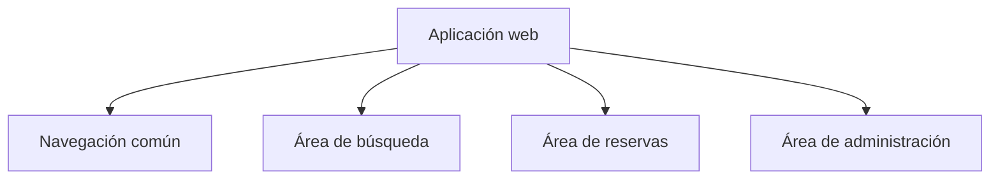

El dibujo muestra áreas funcionales. En una arquitectura de microfrontends, esas áreas no tienen por qué ser simples componentes: pueden tener equipos, ciclos de desarrollo y mecanismos de integración propios.

### ¿Por qué puede interesar?

En una organización grande, distintos equipos pueden necesitar trabajar en áreas diferentes del producto sin coordinar cada cambio con todo el resto del frontend.

### ¿Qué dificultades añade?

- Hay más piezas que integrar y mantener.
- Puede ser más difícil conservar una experiencia visual coherente.
- Hay que coordinar navegación, datos, autenticación y dependencias.
- Puede aumentar el trabajo de despliegue y diagnóstico.
- Una división mal elegida crea más problemas de los que resuelve.

Un microfrontend no es simplemente un componente grande de React. Tiene que ver con cómo se dividen y coordinan partes de un producto frontend, normalmente en un contexto organizativo más complejo.

### Preguntas para conversar

1. ¿Qué problemas ayudan a resolver los componentes?
2. ¿Por qué una aplicación puede necesitar gestionar estado compartido?
3. ¿Qué diferencias generales hay entre React y Angular?
4. ¿Qué ventajas y dificultades pueden tener los microfrontends?
5. ¿Por qué no todas las aplicaciones necesitan Redux ni microfrontends?

---

# Parte 5. DevOps, cloud y SecDevOps

Esta parte sirve como mapa inicial. Los detalles de herramientas y configuraciones se verán en el módulo de DevOps.

## 1. Cloud: utilizar infraestructura como servicio

Para que FitClub funcione en Internet, necesitamos recursos informáticos: capacidad de ejecutar el backend, almacenar datos, recibir conexiones, guardar archivos y controlar el acceso.

Podemos gestionar infraestructura propia o contratar servicios cloud.

Proveedores como **AWS**, Microsoft Azure y Google Cloud ofrecen herramientas para ejecutar aplicaciones, redes, almacenamiento, bases de datos, identidad, seguridad, observabilidad y más.

Una analogía: en vez de construir y mantener todo el edificio donde funciona el gimnasio, podemos contratar distintos servicios e instalaciones a proveedores especializados. Aun así, seguimos teniendo responsabilidades sobre cómo configuramos y utilizamos esos servicios.

## 2. Docker y contenedores

En desarrollo, una aplicación puede funcionar en el ordenador de una persona y fallar en otro entorno por diferencias de dependencias o configuración.

**Docker** y los contenedores ayudan a empaquetar una aplicación con elementos necesarios para ejecutarla de una forma más consistente.

Una analogía: preparar una caja con la aplicación y buena parte de los elementos que necesita para funcionar, de modo que no tengamos que reconstruir el entorno a mano en cada ordenador o servidor.

Los contenedores no solucionan automáticamente todos los problemas de compatibilidad, seguridad o configuración. Son una herramienta dentro de un proceso más amplio.

## 3. CI/CD y pipelines

**CI/CD** agrupa prácticas de integración, comprobación y entrega o despliegue automatizados. Los términos pueden variar ligeramente según cómo se utilicen *delivery* y *deployment*.

Una **pipeline** es una secuencia de pasos automatizados que se ejecutan para comprobar, preparar o publicar cambios.

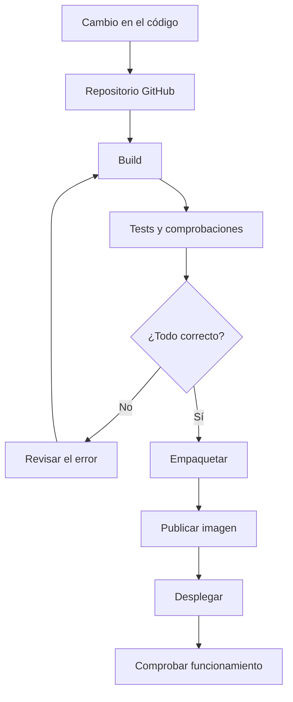

### ¿Qué es un stage?

Un **stage** es una fase de una pipeline. Por ejemplo:

- **Build:** preparar o compilar la aplicación.
- **Test:** ejecutar pruebas automatizadas.
- **Quality / security:** analizar calidad y seguridad.
- **Package:** empaquetar la aplicación, por ejemplo como una imagen de contenedor.
- **Deploy:** desplegar en un entorno.

Los nombres y el orden cambian según el proyecto. Algunas etapas pueden tener varios trabajos o *jobs*.

### GitHub Actions y GitLab CI

**GitHub Actions** permite automatizar flujos de trabajo asociados a un repositorio de GitHub. **GitLab CI/CD** ofrece capacidades similares dentro de GitLab.

La herramienta concreta cambia, pero la idea general se mantiene: definir qué debe ejecutarse, en qué condiciones y qué ocurre si una comprobación falla.

## 4. PR review y automatización

Una Pull Request puede combinar revisión humana con comprobaciones automáticas.

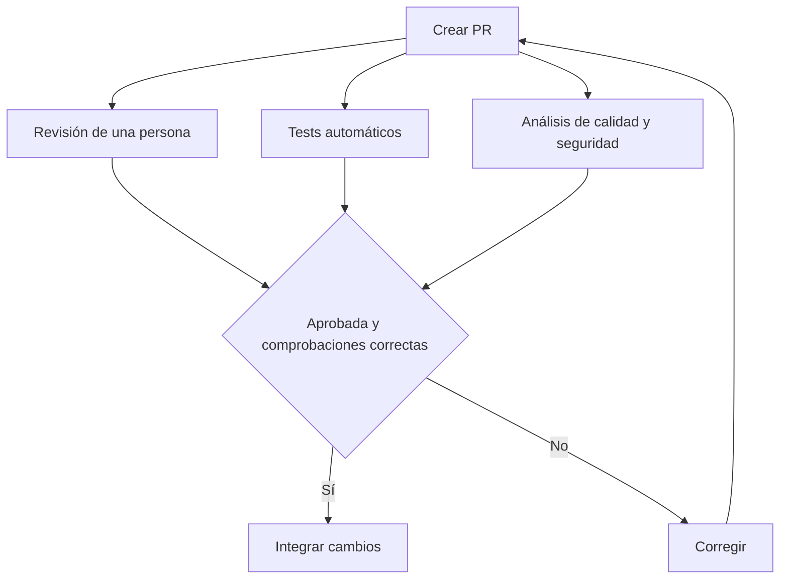

La revisión humana y la automatización se complementan. Las herramientas pueden detectar determinados problemas, pero no entienden necesariamente todos los requisitos ni sustituyen el criterio del equipo.

## 5. SonarQube y otras herramientas de análisis

**SonarQube** analiza código para ayudar a detectar problemas de calidad y determinados riesgos de seguridad. Puede integrarse en un proceso de CI/CD.

También existen herramientas para:

- Detectar vulnerabilidades conocidas en dependencias.
- Identificar secretos que se hayan incluido accidentalmente en el repositorio.
- Analizar imágenes de contenedor.
- Comprobar configuraciones de infraestructura.
- Ejecutar pruebas automatizadas.

Ninguna herramienta detecta todos los problemas. Los resultados necesitan interpretación y un proceso para corregir los hallazgos relevantes.

## 6. SecDevOps: integrar seguridad en el ciclo de desarrollo

**DevSecOps** integra la seguridad durante el ciclo de vida del software. El término **SecDevOps** también se utiliza, con matices distintos según la organización, para destacar esa integración de seguridad en desarrollo y operaciones.

En FitClub, algunas preguntas de seguridad serían:

- ¿Puede cualquier usuario consultar los datos privados de otra persona?
- ¿Quién puede modificar horarios y aforo?
- ¿Dónde se guardan las credenciales y los secretos?
- ¿Cómo se detectan accesos sospechosos?
- ¿Cómo se actualizan dependencias con vulnerabilidades conocidas?

La seguridad no depende de una única persona ni de una herramienta. Es una responsabilidad que debe estar presente en el diseño, el desarrollo, el despliegue y la operación.

## 7. Kubernetes, explicado de forma sencilla

**Kubernetes** es una plataforma para gestionar aplicaciones en contenedores, incluyendo tareas como mantener el número deseado de instancias, reiniciar componentes que fallan y facilitar despliegues.

Una analogía: Docker ayuda a empaquetar y ejecutar una aplicación en un contenedor; Kubernetes ayuda a coordinar muchos contenedores y mantener el sistema en el estado deseado.

No todas las aplicaciones necesitan Kubernetes. Añade capacidades, pero también complejidad operativa.

## 8. GitOps

**GitOps** es un enfoque para gestionar cambios de infraestructura y despliegue utilizando Git como referencia declarativa del estado deseado.

Dicho de forma sencilla: describimos en archivos cómo queremos que esté configurado un entorno, guardamos esos cambios en Git y usamos herramientas para aplicar o reconciliar ese estado.

Se apoya en Git, pero no significa simplemente «usar Git para guardar el código». Tiene que ver con utilizar el repositorio como parte central del proceso de operación.

## 9. Observabilidad: saber qué está pasando

Cuando FitClub falla, necesitamos investigar qué ha ocurrido.

- **Logs:** registros de acontecimientos, mensajes y errores.
- **Métricas:** valores medibles a lo largo del tiempo, como el número de peticiones o el tiempo de respuesta.
- **Trazas:** información que permite seguir una operación mientras atraviesa distintas partes del sistema.

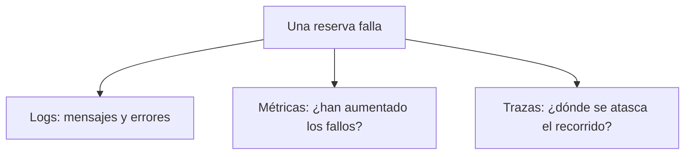

La observabilidad ayuda a investigar problemas, pero no los resuelve por sí sola. Hay que instrumentar los sistemas, interpretar las señales y tomar medidas.

### Preguntas para conversar

1. ¿Por qué automatizar pruebas y despliegues puede reducir errores?
2. ¿Qué diferencia hay entre una PR review y una prueba automatizada?
3. ¿Por qué analizar una imagen de contenedor puede ser importante para la seguridad?
4. ¿Qué ventajas y costes tiene utilizar Kubernetes?
5. ¿Por qué GitOps es más que guardar código en Git?

---

# Parte 6. Biblioteca de referencia

No se espera que leáis todos estos libros. Son referencias conocidas que pueden ayudaros a investigar un tema cuando os interese. Algunos son introductorios; otros son más densos y funcionan mejor como consulta.

## Calidad del código y práctica profesional

### Clean Code — Robert C. Martin


Sobre legibilidad, nombres, funciones y mantenimiento del código.

### Refactoring: Improving the Design of Existing Code — Martin Fowler


Sobre cómo mejorar la estructura interna del código preservando su comportamiento.

### The Pragmatic Programmer — David Thomas y Andrew Hunt


Sobre el oficio de desarrollar software, aprender y tomar buenas decisiones.

### A Philosophy of Software Design — John Ousterhout


Sobre complejidad, modularidad y diseño.

## Patrones y arquitectura

### Head First Design Patterns — Eric Freeman y Elisabeth Robson


Una introducción visual y didáctica a los patrones de diseño.

### Fundamentals of Software Architecture — Mark Richards y Neal Ford


Una visión amplia de estilos arquitectónicos y decisiones de diseño.

### Building Microservices — Sam Newman


Sobre las decisiones y dificultades reales de los sistemas basados en microservicios.

## JavaScript y frontend

### JavaScript: The Definitive Guide — David Flanagan


Una referencia amplia del lenguaje JavaScript; no es necesario leerla entera de principio a fin.

### Learning React — Alex Banks y Eve Porcello


Referencia para profundizar en desarrollo frontend con React.

## Metodologías de desarrollo

### Extreme Programming Explained: Embrace Change — Kent Beck


Un clásico sobre XP y prácticas de desarrollo.

Otros recursos para consultar cuando aparezca un concepto:

- Documentación oficial de React, Angular, Redux y RxJS.
- **The Twelve-Factor App:** principios para diseñar aplicaciones que se despliegan y operan en distintos entornos.
- Documentación de AWS, Azure, Google Cloud, Docker, GitHub Actions y Git.

Un libro no sustituye a la práctica, y esta lista no es una lista de deberes. La idea es saber que existen referencias a las que acudir cuando queramos profundizar.

---

# Cierre: qué quiero que os llevéis

No espero que después de estas sesiones sepáis construir microservicios, diseñar microfrontends, desplegar en AWS o aplicar todos los principios SOLID.

Quiero que os llevéis tres cosas:

1. **Un mapa mental:** entender que una aplicación tiene frontend, backend, datos, infraestructura, seguridad, despliegue y mantenimiento.
2. **Un vocabulario inicial:** reconocer términos que aparecen en documentación, cursos, libros y conversaciones de una empresa.
3. **Una forma de aprender:** cuando encontréis un término nuevo, preguntaros qué problema intenta resolver, qué ventajas aporta, qué complejidad introduce y dónde podéis profundizar.

La tecnología que utilicemos en este bootcamp es importante, pero no será la última que aprendáis. Lo que buscamos es que podáis seguir aprendiendo con criterio cuando os encontréis con tecnologías, herramientas y problemas nuevos.